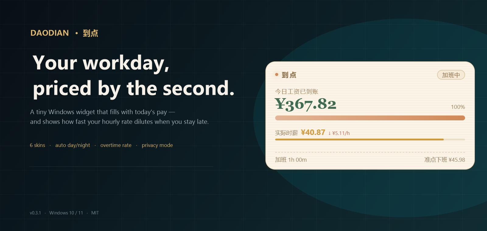
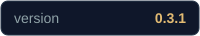
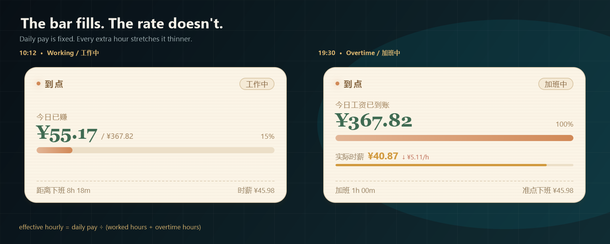
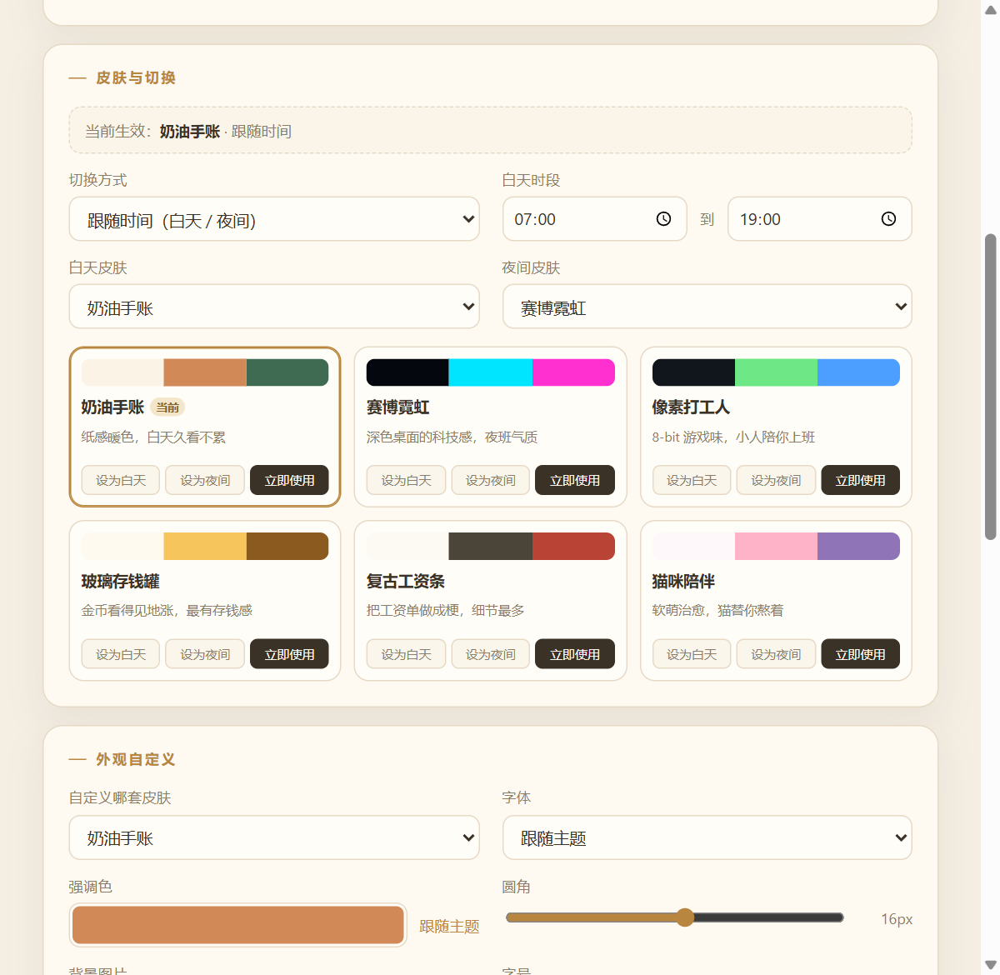

<p align="center">
  
</p>

<h1 align="center"> Daodian · 到点</h1>

<p align="center">
  <b>Your workday, priced by the second.</b><br>
  A tiny Windows widget that fills up with today's pay — and makes the real cost of overtime visible.
</p>

<p align="center">
  <a href="README.md"></a>
  <a href="README.zh-CN.md"></a>
</p>

<p align="center">
  
  
  
  
</p>

---

Most workday counters answer **“how much time is left?”**

Daodian answers a different question: **“how much have I made so far?”** The widget sits in a corner of your desktop, counts your pay up in real time, and — after quitting time — shows how badly every extra minute dilutes your hourly rate.

It is deliberately small. No dashboards, no accounts, no cloud. A salary bar with a little attitude.

<p align="center">
  
</p>

<p align="center"><i>Sample data. At 10:12 the bar is 15% full. By 19:30 it is full — but the effective hourly rate has fallen from ¥45.98 to ¥40.87, and it keeps falling.</i></p>

## Six skins, one salary

<p align="center">
  
</p>

Cream Journal by day, Cyber Neon by night — or pick one and lock it. Every skin can be tuned separately.

## Features

- **A salary bar, not a countdown.** Enter your after-tax monthly salary and pay days; the widget turns your workday into a filling money bar. It updates every 100 ms and pauses during lunch.
- **Overtime dilution, made visible.** After off-work time, the effective hourly rate is recalculated as `earned ÷ total hours`. A second thin bar drains from green to amber to red. There is also an optional 1.5× overtime-pay mode.
- **Six built-in skins.** Cream Journal, Cyber Neon, Pixel Worker, Glass Jar, Retro Payslip, Cat Companion. Day/night defaults switch at 07:00 and 19:00; follow the system theme or lock a skin manually.
- **Make it yours.** Per-skin accent color, local background image, corner radius and font. Global font size and window opacity. Right-click opacity presets from 50% to 100%.
- **Privacy mode.** One click turns every amount into `¥•••` while keeping the progress bar. Useful in an open office, on a screen share, or on a train.
- **A proper desktop citizen.** Frameless and transparent, always on top, draggable, snap-to-edge, remembers its position, lives in the tray, can start with Windows. `Ctrl + Shift + H` hides or shows it instantly.
- **Edge auto-tuck.** Optional: after a configurable delay the card slides into the nearest left/right screen edge, leaving a small glowing handle. Hover the handle and it slides back. Delay is adjustable from 1 to 10 seconds.
- **Clock in / clock out.** On a workday the panel footer carries a punch button: it reads “打卡上班” until you clock in, then “打卡下班” until you clock out. It is available directly on the card all day, not only around the shift edges; the tray and widget menus also offer punch / undo. Clocking out first opens a confirmation with editable clock-in/out times; confirming saves the day and plays a confetti celebration. Settings chooses what a punch means: keep the configured shift (default), use the actual punch times, or a custom mix with a late/early grace.
- **Work statistics, in its own window.** Open “工作统计…” from the widget or tray menu. The month view is a calendar with earnings heat, overtime marks and mood emojis; the year view is a wall of 12 mini calendars; the day view has a completion ring, punch times, a workday ribbon and the mood picker. Today updates live; history lives in `stats.json` on this machine.
- **Mood and notes per day.** Pick one of six moods (😄 🙂 😐 😫 😴 🔥) in the day view and write a short note; the emoji appears in the month calendar and everything stays in `stats.json`.
- **English or Chinese.** The whole interface is translated. Choose English or 中文 in the first-run setup or from the switch in the Settings header; Chinese is the default. Tray menus, dialogs, notifications and the statistics window follow the choice.
- **Updates in place.** Installed builds check GitHub Releases on launch and every six hours and download in the background. When the download finishes the app asks whether to install; nothing installs on quit without confirmation, and the installer window stays visible while it runs. A tray item and the settings page show progress; the check can be disabled. Portable builds can check and open the latest release page.
- **A tiny bit of ceremony.** When the bar fills: confetti, a three-note chime and a Windows notification (each can be disabled).
- **Local only.** No accounts, no telemetry. The only network call is the optional update check against GitHub Releases; everything else lives in a JSON file on your machine.

## Download

| Build | File | Notes |
| --- | --- | --- |
| Installer | [Daodian-0.3.0-Setup.exe](https://github.com/Pumatlarge/daodian/releases/download/v0.3.0/Daodian-0.3.0-Setup.exe) | Per-user install, choose the folder, desktop / Start menu shortcuts |
| Portable | [Daodian-0.3.0-Portable.exe](https://github.com/Pumatlarge/daodian/releases/download/v0.3.0/Daodian-0.3.0-Portable.exe) | Single file, no installation |

[All releases](https://github.com/Pumatlarge/daodian/releases) · Windows 10 / 11 · x64 · Electron 45

> The executables are unsigned. On first launch Windows SmartScreen may show a warning — choose **More info → Run anyway**. The installer keeps your local settings when you uninstall.
>
> Installed builds from 0.2.0 onward update themselves from GitHub Releases. The portable build never self-updates; use its “check for updates” action to open the release page.

## First run

<p align="center">
  
</p>

The three-step setup asks for:

1. **Money** — after-tax monthly salary and the number of paid days per month (21.75 by default).
2. **Hours** — start, end, lunch start and lunch length. The default is 09:00–18:30 with a 90-minute lunch.
3. **Skin** — day skin, night skin, and whether to follow time, the system theme, or a fixed skin.

Use the **中文 / English** switch in the setup header if you want the English interface; Chinese is the default. Work patterns include fixed Mon–Fri, alternating “big/small weeks” (大小周), and six-day weeks (单休). The widget lands in the bottom-right corner; drag it wherever you like.

## How the money is calculated

```text
dailyPay        = afterTaxMonthlySalary ÷ payDays
normalHourly    = dailyPay ÷ effectiveDailyHours
earned          = workedSeconds × (dailyPay ÷ effectiveDailySeconds)
effectiveHourly = earned ÷ ((workedSeconds + overtimeSeconds) ÷ 3600)
```

- `effectiveDailyHours` subtracts the lunch break; earnings are frozen during lunch.
- After off-work time, `effectiveHourly` falls as overtime grows. The thin strip under the rate is `effectiveHourly ÷ normalHourly`.
- In **1.5× overtime mode**, pay keeps growing at `normalHourly × 1.5` instead of diluting.
- On non-workdays the card switches to a quiet “rest day” state and shows the next workday.
- With punch-based pay modes, the day starts at your clock-in and ends at your clock-out (or now while you are still working), with the configured late/early grace; days without a punch still follow the configured shift.

## Settings

<p align="center">
  
</p>

Everything is editable after onboarding:

- Salary, pay days, work pattern (including the current big/small week), start/end, lunch.
- Day/night skins and switching mode; a manual pick temporarily locks the theme until you press “restore auto”.
- Per-skin accent, background image, radius, font; global font size and opacity.
- Display toggles: target, percentage, remaining time, hourly rate, overtime strip, privacy.
- Always-on-top, autostart, notifications, chime, edge auto-tuck and its delay.
- Clock-in calculation mode (schedule / actual punch / custom with grace).
- Interface language: 中文 or English (Chinese by default), switchable at any time.
- Auto-update toggle, current version, check-now and install-update controls, plus a GitHub project link.

## Controls

| Action | What it does |
| --- | --- |
| Drag the card | Move it; it snaps to screen edges and remembers the position |
| Right-click | Skins, opacity, edge auto-tuck, privacy, always-on-top, autostart, statistics, quit |
| Hover the top-right corner | Eye (privacy), pin (auto-tuck), gear (settings) |
| `Ctrl + Shift + H` | Hide / show the widget |
| Tray icon | Left-click toggles; right-click opens the full menu, including statistics and update status |
| Edge handle | Appears while tucked; hover to bring the card back |
| Punch button | Sits in the panel footer on a workday: Clock in, then Clock out; clock-out asks for confirmation with editable times |
| Work statistics… | Opens its own window: month calendar, year wall, day detail; click a day to add a mood and a note |
| Language switch | In the first-run setup or the Settings header: 中文 / English |

## Privacy

Daodian stores only what it needs to draw the widget:

```text
%APPDATA%\到点\config.json       settings, schedule, last position
%APPDATA%\到点\config.json.bak   previous successful save
%APPDATA%\到点\assets\           copies of custom background images
%APPDATA%\到点\stats.json        daily work statistics, moods and notes
```

No analytics and no account. The only network request is the update check against GitHub Releases (on launch and every six hours when auto-update is enabled); it can be disabled in Settings. The config is plain JSON — privacy mode hides the display, not the file. If you edit the file by hand, the app falls back to the `.bak` copy when the main file cannot be parsed.

## Build from source

Requirements: Windows 10/11, Node.js 20+ (tested with Node 24), npm.

```bash
git clone https://github.com/Pumatlarge/daodian.git
cd daodian
npm install
npm start        # run from source
npm test         # 31 calculation tests
npm run dist     # installer + portable build
```

Outputs:

```text
dist/Daodian-0.3.0-Setup.exe
dist/Daodian-0.3.0-Setup.exe.blockmap
dist/latest.yml
dist/Daodian-0.3.0-Portable.exe
```

If Electron or NSIS downloads are slow, set the mirrors first:

```powershell
$env:ELECTRON_MIRROR="https://npmmirror.com/mirrors/electron/"
$env:ELECTRON_BUILDER_BINARIES_MIRROR="https://npmmirror.com/mirrors/electron-builder-binaries/"
npm run dist
```

### Project layout

```text
electron/        main process: window, tray, theme scheduler, store, IPC
src/             widget, settings, first-run wizard
shared/          pure calculation + theme manifest (testable in Node)
assets/          app and tray icons
docs/            screenshots used by this README
tools/           icon and documentation image generators
tests/           calculation tests
```

The UI ships in Simplified Chinese and English; the language lives in `config.json` and the strings in `shared/i18n.js`. The calculation layer is framework-free and covered by `tests/calc.test.js`. Other locales are a welcome contribution.

## Releasing

The installed build updates in place from GitHub Releases. After bumping the version, `npm run dist` generates the update manifest and blockmap. Publish **all four** files for every release after 0.2.0:

```text
Daodian-<version>-Setup.exe
Daodian-<version>-Setup.exe.blockmap
latest.yml
Daodian-<version>-Portable.exe   (optional for updates, useful for portable users)
```

Create the GitHub release with tag `v<version>`, upload the files, and mark it as the latest release. The updater reads `latest.yml` and downloads the Setup from that release. Do not rename `latest.yml`, and keep the blockmap next to the Setup with the matching filename; the updater uses it for differential downloads.

The first updater-enabled build, **0.2.0**, has to be installed manually once. From then on, installed users receive subsequent versions through the in-app updater; portable users always download manually.

## Known limitations

- **Auto-updates start with 0.2.0.** Users on 0.1.x need a one-time manual install of 0.2.0; later versions update in place.
- **Public holidays are not built in.** Days are classified by the work pattern only; 调休/holiday calendars are on the roadmap.
- **Punches are optional.** The default mode follows the configured shift; punches are recorded but do not change the pay. Switch to “actual punch time” or “custom” in Settings to let late arrivals, early leave and overtime come from your punches.
- **Windows only.** The transparent-window and tray behavior is tuned for Windows 10/11.
- **Unsigned builds and updates.** No code-signing certificate is configured; Windows SmartScreen may warn. A signing certificate is recommended for wider distribution.
- **Big/small week anchor.** The alternation is anchored to the week you mark as a “big week”; change jobs or shifts and re-check it.

## Roadmap

- Holiday / 调休 calendar
- Monthly earnings and monthly progress view
- More locales beyond English
- Click-through mode and hide-on-fullscreen
- Full theme editor with import/export

## Contributing

Issues and pull requests are welcome. Please keep `npm test` green, keep the calculation logic in `shared/calc.js` free of DOM/Electron dependencies, and avoid adding telemetry or unrelated network calls.

## License

[MIT](LICENSE) © 2026 Feitong Jiang
