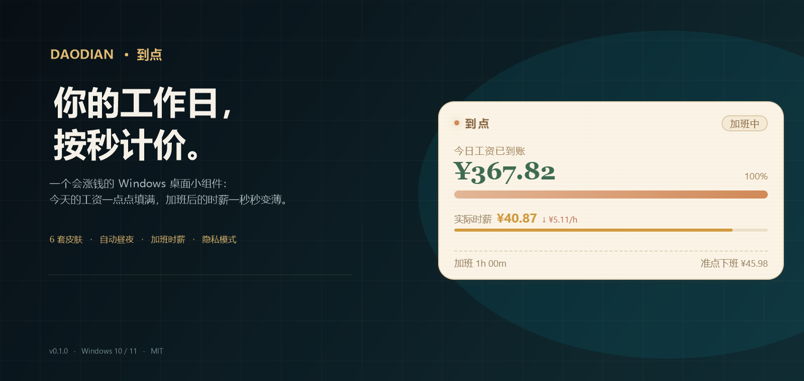
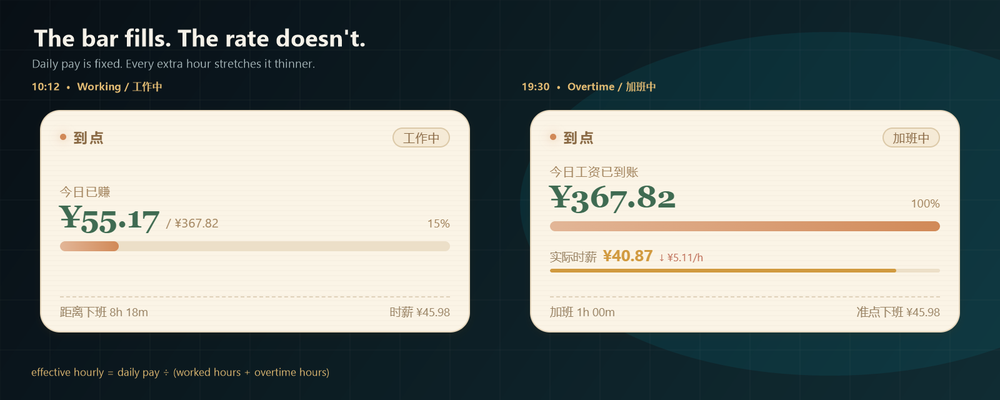

<p align="center">
  
</p>

<h1 align="center"> 到点 · Daodian</h1>

<p align="center">
  <b>你的工作日，按秒计价。</b><br>
  一个会涨钱的 Windows 桌面小组件：今天的工资一点点填满，加班后的时薪一秒秒变薄。
</p>

<p align="center">
  <a href="README.md"></a>
  <a href="README.zh-CN.md"></a>
</p>

<p align="center">
  
  
  
  
</p>

---

大多数下班倒计时回答的是：**「还有多久下班？」**

到点回答的是另一个问题：**「我今天已经赚了多少？」** 小组件蹲在桌面一角，把工资按秒数往上加；下班之后，它还会把「加班让时薪变薄」这件事直接摆在你眼前。

它很小，不做仪表盘、不登录、不联网，只是一条带点脾气的工资进度条。

<p align="center">
  
</p>

<p align="center"><i>示例数据。10:12 时进度条 15%；到 19:30 满格，但实际时薪已经从 ¥45.98 跌到 ¥40.87，而且还会继续跌。</i></p>

## 六套皮肤，同一份工资

<p align="center">
  
</p>

白天奶油手账，晚上赛博霓虹；也可以固定一套。每套皮肤的颜色、背景、圆角和字体都能单独调。

## 功能

- **不是倒计时，是工资条。** 填税后月薪和计薪天数，今天的工作时间就变成一条会涨的钱。每 100ms 更新一次，午休自动暂停。
- **把加班稀释摆出来。** 下班后按 `今日已赚 ÷ 总工时` 实时重算实际时薪；下面一条细进度条会从绿变黄变红。也可以在设置里切成 1.5 倍加班费模式。
- **六套内置皮肤。** 奶油手账、赛博霓虹、像素打工人、玻璃存钱罐、复古工资条、猫咪陪伴。默认 07:00 / 19:00 自动昼夜切换；也能跟随系统或手动锁定。
- **可以改成自己的样子。** 每套皮肤单独设强调色、本地背景图、圆角、字体；全局调字号和窗口透明度。右键菜单里还有 50%–100% 的透明度快捷选项。
- **隐私模式。** 一键把金额变成 `¥•••`，只保留进度条。开放工位、投屏、地铁上都用得着。
- **像个正常的桌面居民。** 无边框透明、置顶、可拖动、贴边吸附、记住位置、托盘常驻、开机自启，`Ctrl + Shift + H` 秒隐藏。
- **边缘自动收纳。** 可选：鼠标离开一段时间后，卡片滑进最近的左 / 右屏幕边缘，只留一个发光小把手；鼠标碰到把手再滑回来。延迟 1–10 秒可调。
- **打卡上下班。** 上班 / 下班时间附近，卡片底部会出现打卡按钮。设置里可以决定打卡怎么计薪：仍按设置的班次（默认，打卡只记录时间）、按实际打卡时间，或者自定义迟到 / 早退宽限和加班规则。
- **工作统计，独立窗口。** 从小组件或托盘菜单打开「工作统计…」。月视图是带工资热力、加班标记和心情表情的日历；年视图是 12 个迷你月历；日视图有完成度圆环、打卡时间、班次时间轴和心情选择。今天实时更新，历史保存在本机 `stats.json`。
- **心情和备注。** 日视图里可以选 6 种心情（😄 🙂 😐 😫 😴 🔥）并写一段备注，心情表情会显示在月历里，数据保存在 `stats.json`。
- **中英文切换。** 界面完整支持英文，在首次设置或设置页顶部的语言开关里选择中文 / English；默认中文。托盘菜单、对话框、通知和统计窗口都会跟随切换。
- **安装版原地更新。** 启动时和每 6 小时检查 GitHub Releases 并后台下载；下载完成后会先询问是否安装，确认后才打开安装程序，不会在退出时静默安装。托盘和设置页显示进度，也可以手动检查。便携版只能检查后打开下载页，自动检查可以在设置里关。
- **一点点仪式感。** 满格时金币粒子 + 三声轻响 + Windows 通知，都能单独关。
- **纯本地。** 不登录、不埋点；唯一的联网是检查更新（可关），其他数据都在本机一个 JSON 文件里。

## 下载

| 版本 | 文件 | 说明 |
| --- | --- | --- |
| 安装包 | [Daodian-0.3.0-Setup.exe](https://github.com/Pumatlarge/daodian/releases/download/v0.3.0/Daodian-0.3.0-Setup.exe) | 当前用户安装，可选目录，创建桌面 / 开始菜单快捷方式 |
| 便携版 | [Daodian-0.3.0-Portable.exe](https://github.com/Pumatlarge/daodian/releases/download/v0.3.0/Daodian-0.3.0-Portable.exe) | 单文件，免安装 |

[全部版本](https://github.com/Pumatlarge/daodian/releases) · Windows 10 / 11 · x64 · Electron 45

> 程序没有代码签名，首次运行 Windows SmartScreen 可能提示，点 **更多信息 → 仍要运行** 即可。卸载安装包时不会删除你的本地设置。
>
> 从 0.2.0 开始，安装版会从 GitHub Releases 自动更新；便携版不会自动更新，点「检查更新」会打开 Releases 页面。

## 第一次打开

<p align="center">
  
</p>

三步引导会问：

1. **钱** —— 税后月薪和每月计薪天数（默认 21.75 天）。
2. **时间** —— 上班、下班、午休开始和午休时长。默认 09:00–18:30，午休 90 分钟。
3. **皮肤** —— 白天皮肤、夜间皮肤，以及跟随时间 / 跟随系统 / 固定一套。

工作日模式支持固定双休、大小周、单休。设置完成后小组件出现在屏幕右下角，拖到顺手的位置就好。

## 钱是怎么算的

```text
日薪     = 税后月薪 ÷ 计薪天数
正常时薪 = 日薪 ÷ 每天有效工时
今日已赚 = 已工作秒数 × (日薪 ÷ 有效工时秒数)
实际时薪 = 今日已赚 ÷ ((已工作小时 + 加班小时) × 3600)
```

- 有效工时扣掉午休；午休期间工资冻结，不再增长。
- 下班后实际时薪会随着加班时间下降；时薪下面的细条就是 `实际时薪 ÷ 正常时薪`。
- **1.5 倍加班费模式**下，工资按 `正常时薪 × 1.5` 继续累计，不再稀释。
- 非工作日会切到安静的「今天休息」状态，并显示下次上班时间。

## 设置

<p align="center">
  
</p>

引导结束后所有东西都能改：

- 月薪、计薪天数、工作日模式（包括本周是大周还是小周）、上下班、午休。
- 白天 / 夜间皮肤和切换方式；手动选一套会临时锁定，点「恢复自动切换」回到时间规则。
- 每套皮肤的强调色、背景图、圆角、字体；全局字号和透明度。
- 显示项：目标、百分比、剩余时间、时薪、加班时薪条、隐私模式。
- 置顶、开机自启、到点通知、音效、边缘自动收纳和延迟。
- 打卡计薪方式（按班次 / 按实际打卡 / 自定义宽限）。
- 界面语言：中文 / English，默认中文，随时可切换。
- 自动更新开关、当前版本、检查更新、安装更新，以及 GitHub 项目主页链接。

## 操作

| 操作 | 效果 |
| --- | --- |
| 拖动卡片 | 移动位置；靠近屏幕边缘会吸附，并记住位置 |
| 右键 | 皮肤、透明度、边缘收纳、立即收纳、隐私、置顶、自启、工作统计、退出 |
| 悬停右上角 | 眼睛（隐私）、图钉（自动收纳）、齿轮（设置） |
| `Ctrl + Shift + H` | 隐藏 / 显示小组件 |
| 托盘图标 | 左键显示 / 隐藏，右键完整菜单（含工作统计和更新状态） |
| 边缘小把手 | 收纳后出现，鼠标碰上去卡片滑回来 |
| 打卡按钮 | 上下班时间附近出现；记录打卡，并在启用实际打卡计薪时改变当天金额 |
| 工作统计… | 打开独立统计窗口：月历、年历、日详情；点某一天可以写心情和备注 |
| 语言开关 | 首次设置或设置页顶部：中文 / English |

## 隐私

到点只保存绘制小组件需要的东西：

```text
%APPDATA%\到点\config.json       设置、班次、最后位置
%APPDATA%\到点\config.json.bak   上一次成功保存的自动备份
%APPDATA%\到点\assets\           自定义背景图的本地副本
%APPDATA%\到点\stats.json        按日期保存的工作统计、心情和备注
```

没有埋点、没有账号。唯一的网络请求是检查 GitHub Releases 更新（默认启动时和每 6 小时一次，可在设置里关闭）。配置和统计都是纯 JSON，隐私模式隐藏的是显示，不是文件。如果你手动改坏了主配置，程序会尝试读取 `.bak`。

## 从源码构建

需要 Windows 10/11、Node.js 20+（开发时用 Node 24）、npm。

```bash
git clone https://github.com/Pumatlarge/daodian.git
cd daodian
npm install
npm start        # 从源码运行
npm test         # 17 个计算测试
npm run dist     # 同时构建安装包和便携版
```

输出：

```text
dist/Daodian-0.3.0-Setup.exe
dist/Daodian-0.3.0-Setup.exe.blockmap
dist/latest.yml
dist/Daodian-0.3.0-Portable.exe
```

Electron 或 NSIS 下载慢的话，可以先设镜像：

```powershell
$env:ELECTRON_MIRROR="https://npmmirror.com/mirrors/electron/"
$env:ELECTRON_BUILDER_BINARIES_MIRROR="https://npmmirror.com/mirrors/electron-builder-binaries/"
npm run dist
```

### 目录

```text
electron/        主进程：窗口、托盘、主题调度、配置、IPC
src/             小组件、设置页、首次引导
shared/          纯计算逻辑 + 主题清单（可在 Node 下测试）
assets/          应用和托盘图标
docs/            README 使用的截图
tools/           图标与文档图片生成脚本
tests/           计算测试
```

界面目前是简体中文；计算层不依赖 DOM / Electron，欢迎补英文界面。

## 发布新版本

安装版会从 GitHub Releases 原地更新。改版本号后运行 `npm run dist`，会同时生成更新清单和 blockmap。0.2.0 之后的每个 Release 都要上传这四类文件：

```text
Daodian-<version>-Setup.exe
Daodian-<version>-Setup.exe.blockmap
latest.yml
Daodian-<version>-Portable.exe   （自动更新不需要，但便携版用户要手动下载）
```

创建 tag 为 `v<version>` 的 Release，上传这些文件，并标记为 latest。更新器读取 `latest.yml`，从该 Release 下载 Setup；不要重命名 `latest.yml`，blockmap 要和 Setup 保持同名并放在旁边，更新器会用它对下载做差分。

第一个带更新器的版本是 **0.2.0**，需要已安装用户手动装一次；从那以后安装版才能自动收到后续版本。便携版始终手动下载。

## 已知限制

- **自动更新从 0.2.0 开始。** 0.1.x 用户需要手动装一次 0.2.0，之后的版本才会原地更新。
- **法定节假日没有内置。** 只按工作日模式判断，调休 / 节假日日历在路线图里。
- **打卡是可选的。** 默认仍按设置的班次计算，打卡只记录时间、不影响金额；在设置里切到「按实际打卡时间」或「自定义」，迟到、早退和加班才会按打卡时间变化。
- **只支持 Windows。** 透明窗口和托盘行为是针对 Windows 10/11 调的。
- **没有代码签名。** 安装包、便携版和自动更新都没有签名证书；Windows SmartScreen 可能提示。正式分发建议配证书。
- **大小周有锚点。** 以你标记为「大周」的那一周为锚点隔周交替；换工作或换班次后记得重新勾一下。

## 路线图

- 节假日 / 调休日历
- 本月累计和月薪进度
- 英文界面与其他语言
- 鼠标穿透、全屏自动隐藏
- 完整的主题编辑器与导入导出

## 参与

欢迎提 Issue 和 PR。提交前请保证 `npm test` 全绿；计算逻辑请留在 `shared/calc.js`，不要引入 DOM / Electron 依赖；不要加入埋点或与更新无关的网络请求。

## 许可

[MIT](LICENSE) © 2026 Feitong Jiang
